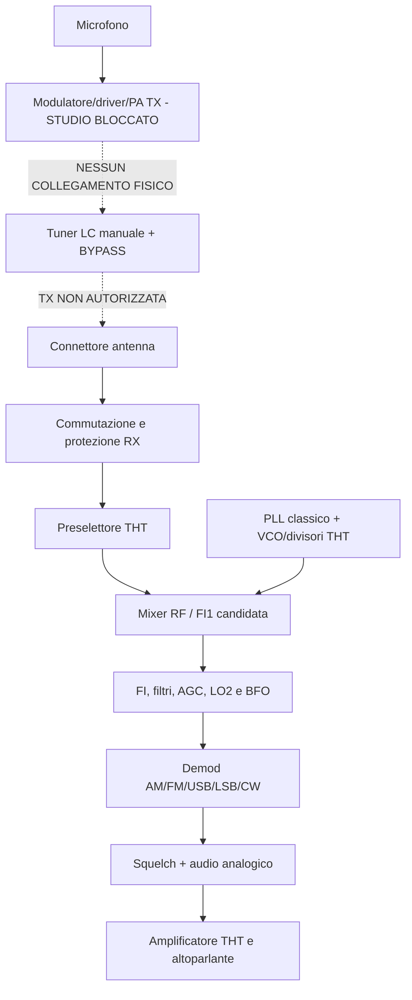

# Schema a blocchi V0.1 — non circuitale

I tratteggi TX indicano **assenza di collegamento elettrico autorizzato**, non fili da implementare. L'architettura è candidato funzionale, non uno schema KiCad.
