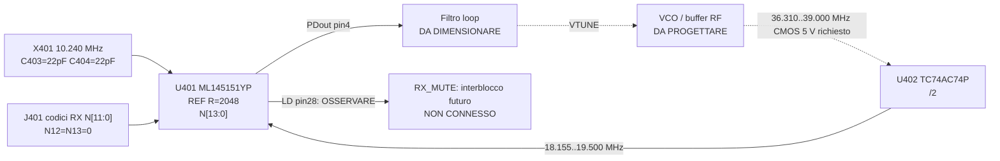

# V0.3 — Nucleo PLL classico THT, primo circuito a livello pin-net

**Data:** 10/11/2026. **Stato:** progetto circuitale preliminare RX-only, NON schematico KiCad certificato, NON PCB. L'architettura è autonoma e non deriva da schemi della versione SMD.

## Decisione provvisoria
**Alternativa A1 preferita per ingegnerizzazione:** `U401 = Lansdale ML145151YP` in DIP28, versione aftermarket originale del Motorola MC145151P2 (NXP lo indica obsoleto). Lansdale pubblica datasheet, riferimento incrociato e modalità di richiesta preventivo; **prezzo, piccole quantità, produzione e lead-time NON confermati**. Se non è acquistabile in quantità adatte, non cambiare automaticamente package: riprendere l'alternativa B `CD74HC4046AE + TC74AC161P` verificando catene sincrone e pulse-width.

**Divisore clock:** `U402 = Toshiba TC74AC74P(F)` DIP14, doppio flip-flop D; prima metà usata come /2 con `/Q → D`, LO 36.310..39.000 MHz verso `CLK`, Q = 18.155..19.500 MHz verso U401 pin1. Seconda metà mantenuta in reset con ingressi a livelli definiti. Toshiba riporta DIP14 e frequenza minima garantita a 5 V di 100 MHz per il FF su condizioni di datasheet: 39 MHz è nel range di frequenza **logico del chip**, ma driver/slew/segnale RF NON dimostrati.

## Nucleo elettrico e nodi

**U401 DIP28:** pin 2 VSS/GND, pin 3 VDD/+5V_PLL, pin 1 `fin` da U402 pin5, pin 4 `PDout` segnale error pulse, pin 27 `OSCin`, pin 26 `OSCout`. Per il divisore riferimento 2048: **RA2 pin7=1, RA1 pin6=0, RA0 pin5=1**. Pin21 `T/R=1` tramite resistenza di bias: elimina OFFSET +856; non è un comando TX fisico. N0..N11 su 12 linee parallele di selezione canale; N12 pin22=N13 pin23=0. Tutte le 270 parole N stanno a 12 bit (3631..3900). U401 pin28 `LD` è sola osservazione: non impiegare il lock detect come unico consenso RX/TX.

**U402 DIP14:** 14=+5V, 7=GND, FF1 pin3 CLK da `LO1_CMOS_BUFFERED`, pin2 D↔pin6 Qbar, pin5 Q→U401 pin1, pin4 /PRE a livello alto, pin1 /CLR a `PRESCALER_RESET_N` definita da pull-up R403/RC C406 provvisori. FF2 non utilizzato: pin10 /PRE=1, pin13 /CLR=0, pin11 CLK=0, pin12 D=0, pin8 e pin9 uscite senza connessioni. **Il reset RC non è una protezione brownout né un interblocco di sicurezza.**

### Riferimento quarzo e capacità di carico

X401 candidato: Citizen `HC-49/U-S10240000ABJB`, **10,240 MHz fondamentale, CL 18 pF, THT**, ±30 ppm frequenza iniziale e ±50 ppm stabilità (valori catalogo). Circuito Pierce interno U401 come da datasheet Lansdale: `XTAL_IN (pin27)` → cristallo → nodo `XTAL_LEFT` → R401 serie 0 Ω candidato → `XTAL_DRIVE (pin26)`; C403 da XTAL_IN a GND, C404 da XTAL_LEFT a GND, entrambe **22 pF C0G THT candidate**. Il feedback Rf è rappresentato nel blocco interno del sintetizzatore; non assumere che serva una resistenza esterna. Verificare drive, ESR e partenza a temperatura prima di fissare R401.

Per Cin=5 pF, Cout=6 pF, Ca=1 pF come da figura del produttore, Co **assunto** 3 pF, C1=C2=22 pF, il carico approssimato è **17,727 pF**. Non è una misura e Co/stray sul PCB possono cambiare il valore.

**Problema precisione per la SSB:** ±30 ppm iniziali su LO fino a 39 MHz corrispondono a **±1170 Hz**; se si combinano pessimisticamente ±30 + ±50 ppm il budget diventa circa **±3120 Hz**. Questo quarzo può essere un candidato di **prova del banco digitale**, ma **non un riferimento SSB definitivo**; serve riferimento THT con qualità/frequenza calibrata e budget di deriva misurabile, senza occultare SMD dentro moduli adattatori.

### Canale prova CH9
`RF_D9=27,065 MHz`, `LO1=37,760 MHz`, `PLL_FEEDBACK=18,880 MHz`, `fPD=5.000 Hz` ⇒ `N=3776=0xEC0=0b111011000000`. Impostare per prova i bit **N6,N7,N9,N10,N11 HIGH** e **N0..N5,N8 LOW**. N12=N13 LOW. Il cablaggio di prova è temporaneo, **non costituisce un selettore fisico di 270 canali**; per la radio finale serve una codifica parallela THT a prova di sequenze invalidanti.

### Uscite, filtro e VCO
- `U401/4 PDout` su `PLL_PD_RAW`: non pilotare direttamente una bobina o varicap. Il **filtro d'anello compensato** e un eventuale buffer sono **da dimensionare** in base a `K_VCO`, `K_PD`, impedenze, frequenza naturale, rumore e margine di fase.
- `LO1_CMOS_BUFFERED` a U402/3 deve essere un clock con ampiezza CMOS e tempi di salita adeguati, proveniente da buffer/limitatore RF THT, **non** un generatore sinusoidale collegato senza condizionamento.
- Prestudio tank ideale VCO con L=220 nH (NON MPN): C_eff richiesta **87,330 pF** a 36,310 MHz e **75,699 pF** a 39,000 MHz. Occorre una variazione effettiva di **11,632 pF**, rapporto Cmax/Cmin≈1,154. Questo dimostra soltanto l'ordine di grandezza con la relazione `f=1/(2π√(LC))`, non che una varicap THT disponibile, accoppiamenti e transistor reali coprano la banda o siano stabili.
- La rete `LD` e i test point `phiR`, `phiV`, `fV` non sono un consenso TX. **NO FAB / NO TX.**

### Alimentazione ed esecuzione successiva
`+5V_PLL` è **rail regolata ESTERNA non ancora progettata**. C401 100 nF + C402 10 µF presso U401 e C405 100 nF presso U402; polarità, dissipazione, massa e return path da concretizzare in schematico KiCad. Prevedere reset supervisionato e RX mute hardware separato. I codici N non possono essere lasciati flottanti nella versione produttiva anche se il PLL offre pullup interni: una parola non valida o transitoria deve inibire l'audio RX.

**Obiettivo immediatamente successivo V0.4:** ottenere una fornitura THT fattibile di U401, completare VCO/buffer/filtro/controlli N, passare da pin-net a .kicad_sch nativo ed eseguire ERC reale. Tutte le interfacce ancora aperte sono etichettate; nessun Gerber prima dei gate.

## Fonti produttori e commerciali
- Lansdale datasheet https://www.lansdale.com/datasheets/ML145151_ML145152_ML145155_ML145156_ML145157_ML145158_revA.pdf (pinout, fIN, oscillator, R code).
- Lansdale stock/quote https://www.lansdale.com/order_info.php (quotazione su richiesta).
- Toshiba TC74AC74P https://toshiba.semicon-storage.com/eu/semiconductor/product/general-purpose-logic-ics/detail.TC74AC74P.html
- Toshiba datasheet https://toshiba.semicon-storage.com/info/docget.jsp?did=3156&prodName=TC74AC74P
- Quarzo Citizen https://www.digikey.com/en/products/detail/citizen-finedevice-co-ltd/HC-49-U-S10240000ABJB/284210
- NXP MC145151 dismesso https://www.nxp.com/products/MC145151_2
